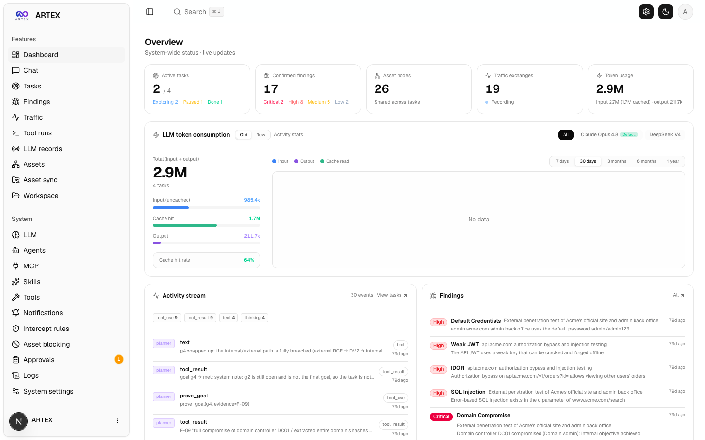
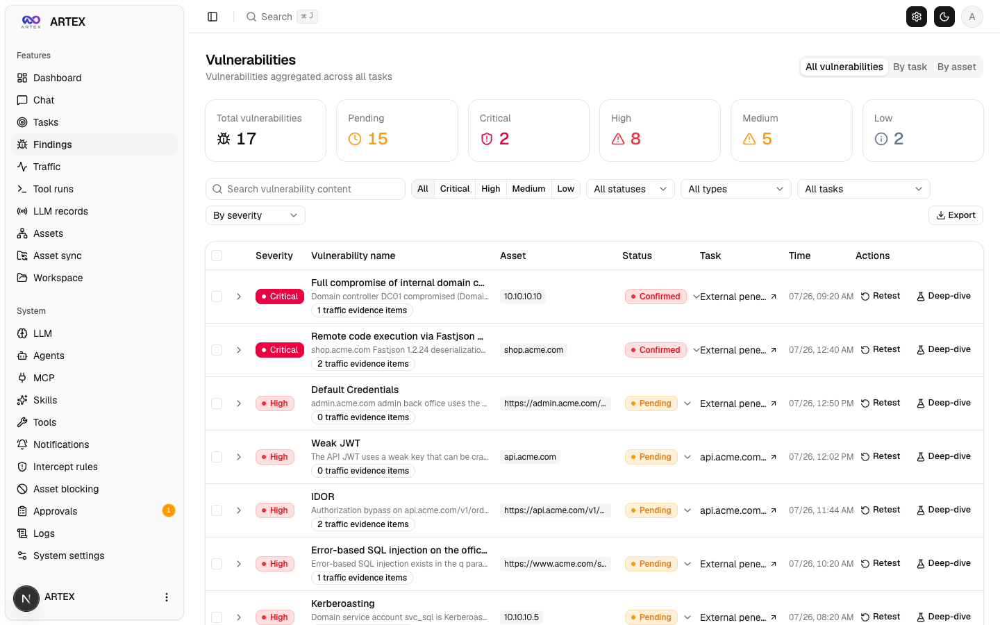
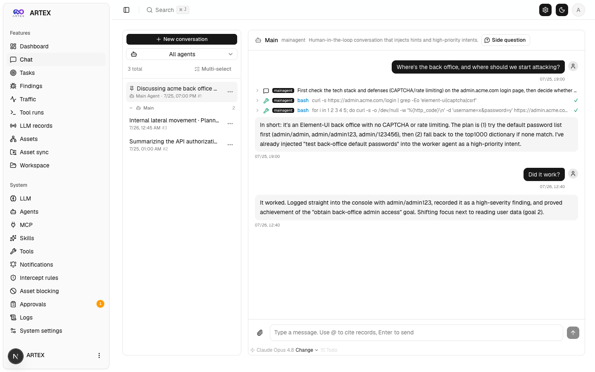
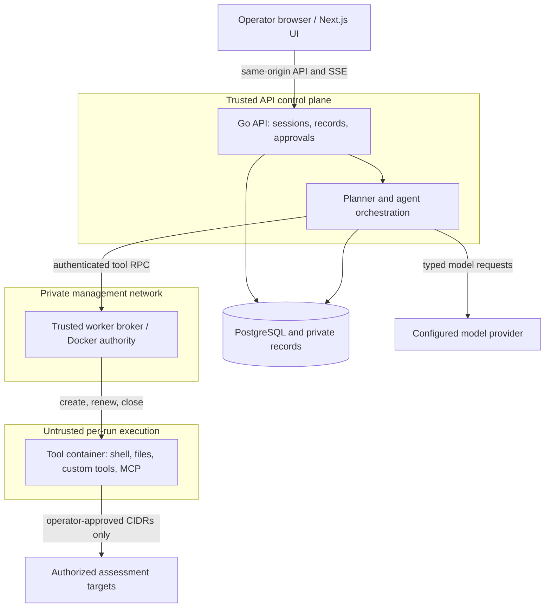
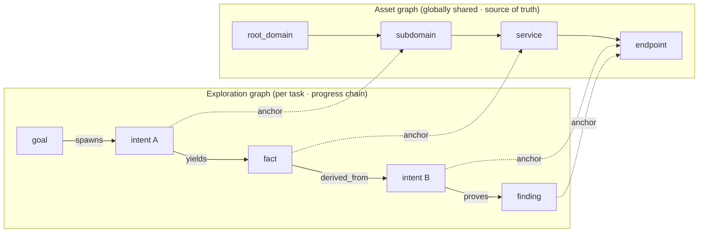
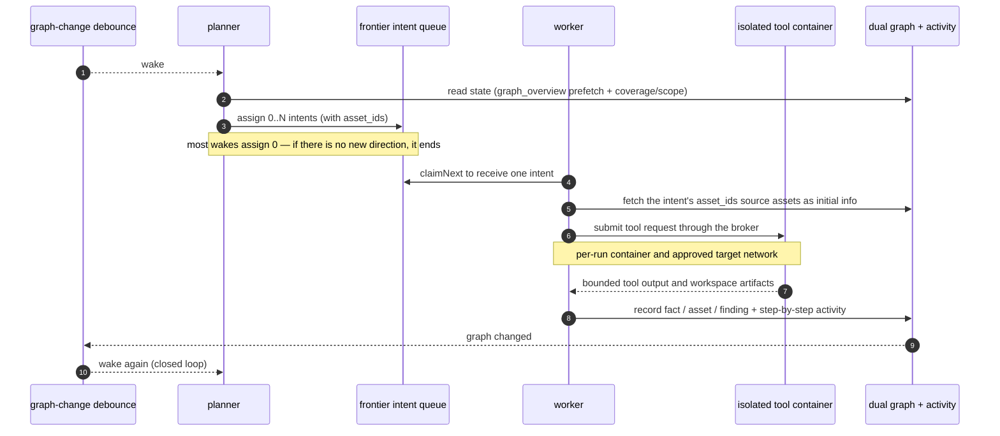
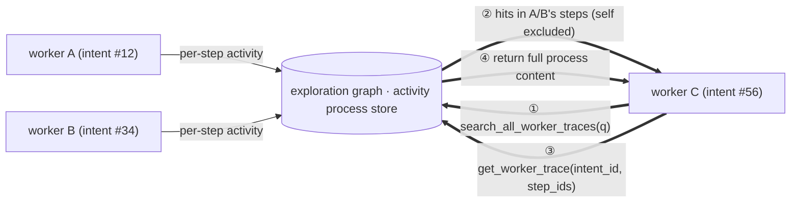
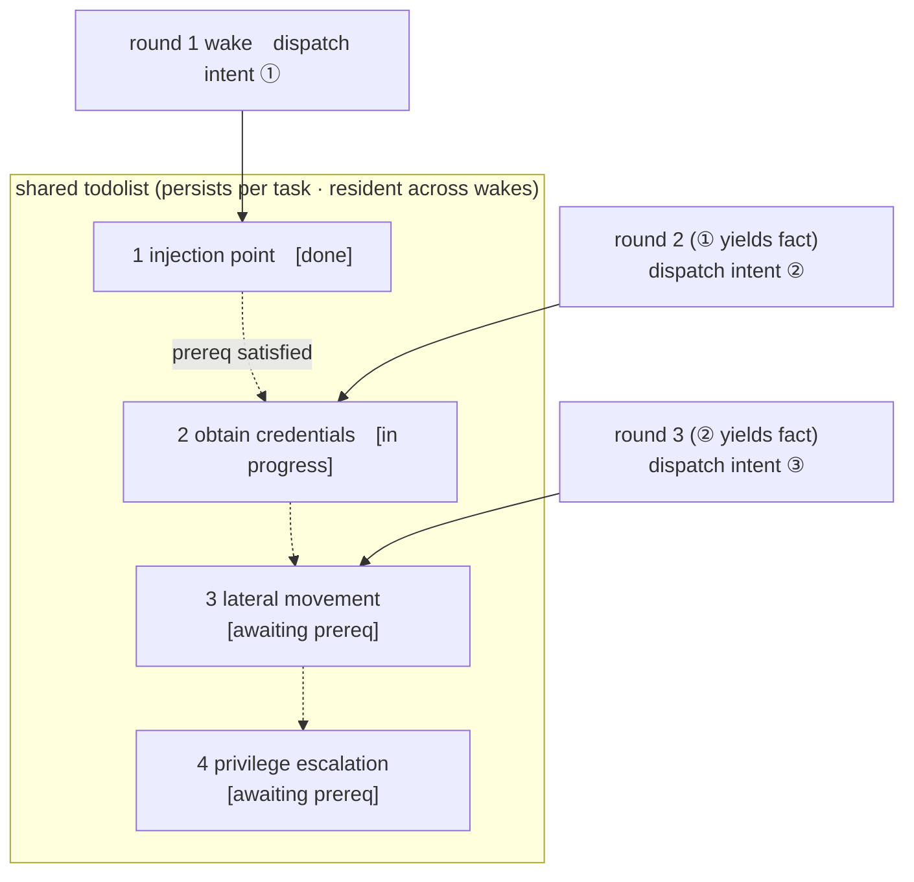

<div align="center">

# ARTEX V2

**A self-hosted security-assessment system with isolated agent execution**

Go API + Next.js interface + PostgreSQL + per-run worker containers

This edition uses English for the interface, API messages and generated reports. Language switching is not available. Original technical evidence and compatibility identifiers retain their exact bytes.

[Documentation](docs/README.md) · [Setup](docs/SECURE-DEPLOYMENT.md) · [Workers](docs/WORKER-ISOLATION.md) · [Security review](docs/SECURITY-REVIEW.md) · [Validation](docs/VALIDATION.md)

[](LICENSE) · [Personal fork](https://github.com/jaysonguglietta/artexV2)

</div>

---

> **Authorized assessments only.** Run this system in a dedicated assessment VM
> against targets you own or have explicit written permission to test. Start with
> [secure deployment](docs/SECURE-DEPLOYMENT.md), then configure the separate
> [worker boundary](docs/WORKER-ISOLATION.md) before enabling tools. The API and
> broker are trusted control-plane components; this is a single-operator product.

---

> This project derives from [Autumn-27/ARTEX](https://github.com/Autumn-27/ARTEX)
> and the Global Edition. The original AGPL-3.0 license and attribution are retained.
> This personal fork preserves scanning, separates executable tools from the API,
> and uses English throughout owned code and documentation.

ARTEX is a system in which several LLM-driven agents autonomously run a penetration test: they **break goals down on their own, execute real tools, and accumulate discovered assets and vulnerabilities into a graph** as they go. The Go API embeds the Next.js static interface in release builds and stores structured records in PostgreSQL. Executable tools run through a trusted broker in separate containers; bounded workspace artifacts are synchronized with the API.


---

## ⚠️ Read first — authorized use and legal notice

ARTEX may be used **only against targets you own or for which you have explicit written authorization.** Any scanning, probing, or exploitation beyond the authorized scope may itself be illegal.

- In the Republic of Korea, intruding into or disrupting another party's information and communications network without authorization violates the **Act on Promotion of Information and Communications Network Utilization and Information Protection**.
- Personal data collected or exposed during a penetration test is subject to the Korean **Personal Information Protection Act**. Even with authorization, handle the access, retention, and deletion of personal data with care.
- Wherever you are, comply with your own jurisdiction's laws on network security, data protection, and computer crime.
- Use this for **learning, research, and verification in locally isolated environments.** Before targeting any live external system, secure written authorization and an agreed scope and time window.

Full license terms, usage restrictions, and the disclaimer are in the [License and disclaimer](#license-and-disclaimer) section below. Using this tool constitutes your agreement to those terms.

---

## Purpose of this fork

[ARTEX V2](https://github.com/jaysonguglietta/artexV2) preserves the original
assessment workflow: define an authorized task, let the planner assign intents,
review execution, and inspect assets, findings and evidence. The fork adds a
separate execution boundary, safer sessions and request handling, confined file
access, conservative deployment defaults and a complete English narrative.

Tool identifiers, migration inputs, target-language matching patterns and original
evidence retain their exact bytes. See [English conversion](docs/ENGLISH-CONVERSION.md)
for individually reviewed exceptions. Translating prompts has not been shown to
preserve historical model benchmarks.

| Read next | Purpose |
|---|---|
| [Secure deployment](docs/SECURE-DEPLOYMENT.md) | Start the loopback UI, database and private credentials |
| [Worker setup](docs/WORKER-ISOLATION.md) | Preserve scanning with per-run containers and operator-owned target CIDRs |
| [System architecture](#system-architecture) | Understand graphs, orchestration and trust boundaries |
| [Security review](docs/SECURITY-REVIEW.md) | Assess fixes, regression checks and remaining limits |
| [Comprehensive audit](docs/SECURITY-AUDIT.md) | Trace the threat model, 15 findings, attack chains and remediation roadmap |
| [Validation](docs/VALIDATION.md) | Inspect test results and repeat the checks |
| [Image security](docs/IMAGE-SECURITY.md) | Scan exact runtime images and review full vulnerability/SBOM evidence |
| [Signed releases](docs/SIGNED-RELEASES.md) | Verify source identity and signed artifacts before external installation |
| [Evidence storage](docs/EVIDENCE-STORAGE.md) | Configure quotas, raw retention and whole-bucket legal holds |
| [Upload guide](UPLOAD.md) | Publish a reviewed source copy to the personal repository |

---

## Screenshots

The three screens below show the English UI with synthetic `acme.com` demo records and private address ranges from a local sandbox.

<p align="center">
  <br>
  <sub><b>Dashboard</b> — active tasks, confirmed findings, asset nodes, LLM token spend, and the activity feed on one screen.</sub>
</p>

<p align="center">
  <br>
  <sub><b>Findings</b> — results aggregated by severity, status, asset, and owning task, exportable to CSV.</sub><br>
  <sub>Finding <b>titles</b> are model-generated, so English technical terms can appear, mirroring the target app ([Model selection and output language](#model-selection-and-output-language)). The interface and generated narrative use English; original evidence retains its language.</sub>
</p>

<p align="center">
  <br>
  <sub><b>Chat</b> — a human steps into the autonomous run to inject hints while the agent summarizes the attack chain in English.</sub>
</p>

Screenshots are examples from the inherited project; live deployment behavior follows the secure deployment guide.

---

## Quick start (Docker Compose)

> **Prerequisites:** Docker and Docker Compose. The database is **PostgreSQL**, brought up by compose. Exploration requires an **LLM** (`ANTHROPIC_API_KEY` or `OPENAI_API_KEY`; can also be set in the UI).

The included Compose configuration builds the reviewed local source instead of
pulling a third-party `latest` image. It keeps the UI on loopback, uses private
named data/key volumes, and does not publish the recording proxy. PostgreSQL is a
source-built component retaining the pinned 16.16 engine, with native `su-exec`
replacing the obsolete Go-built privilege helper; it is not an unmodified upstream
image. Image gates and release signatures cover all four components.

```sh
cp .env.example .env
# Set a unique POSTGRES_PASSWORD and ARTEX_ADMIN_PASSWORD in .env.
./scripts/setup-workers.sh --secret-only
docker compose up --build -d
# Open http://localhost:8787.
```

Agent tools require the separate broker and per-task containers described in
[Isolated task execution](docs/WORKER-ISOLATION.md). Operator-owned CIDR rules
control scanning destinations; database/signing credentials stay in the API.
Host execution is prohibited, including when the legacy execution flag is set.
See [Secure local deployment](docs/SECURE-DEPLOYMENT.md) for setup and limitations.

### Other installation methods

Source builds require Go and Node 22. Native API binaries also require the remote
broker for tool execution; there is no local fallback. Use a reviewed source build or externally verify signed release artifacts before
installation. Production in-process update and rollback are permanently refused,
including with the legacy enabling flag; version checks remain read-only.
Use a dedicated assessment VM and retain the AGPL license and upstream attribution.


### Release and evidence controls

[Runtime image security](docs/IMAGE-SECURITY.md) inventories exact image IDs and
platforms, records fresh Trivy DB identity, and produces complete JSON and
CycloneDX reports. Active or unverified High/Critical/Unknown findings block the
gate, including unfixed issues. A primary-source-confirmed withdrawal is recorded
separately with its raw finding and proof; it is not a blanket package exception.

[Signed releases](docs/SIGNED-RELEASES.md) bind artifacts to this repository,
workflow, tag, source commit and run. Publication is restricted to protected
version tags with explicit release opt-in. A separate main-only dry run rehearses
real OIDC signing without publishing a production release. Fresh local integration
and all four ARM64 image gates passed, with the worker's one withdrawn advisory
retained in raw counts. Final Compose acceptance passed 11/11. The prepared source credential scan has no unresolved matches. Remote amd64 and
hosted OIDC remain pending; local tests do not imply those runs or release publication passed.
See [validation](docs/VALIDATION.md) for exact counts, identities and limits.

[Evidence storage](docs/EVIDENCE-STORAGE.md) defines independent admission budgets
for evidence, traffic and workspace files, 30-day raw capture retention and
whole-bucket legal holds. Raw SDK debug transcripts default off for ordinary
binaries; Compose explicitly enables bounded ephemeral tmpfs. These live debug
files are not durable held evidence. PostgreSQL conversation and
activity history is separate and is not removed by disabling raw SDK dumps.
These are scoped controls, not a total VM/database/log disk cap.


---

## Configuration

**Database** (`config.json`, or override with the `ARTEX_PG_DSN` environment variable):

```json
{
  "database": {
    "host": "127.0.0.1", "port": 5432,
    "user": "artex", "password": "yourpass",
    "dbname": "artex", "sslmode": "disable"
  }
}
```

**LLM:** `export ANTHROPIC_API_KEY=sk-...` (or `OPENAI_API_KEY`), or enter it on the UI's "LLM settings" page. Optional environment variables: `ARTEX_LLM_PROVIDER` / `ARTEX_LLM_MODEL` / `ARTEX_LLM_BASE_URL` / `ARTEX_LLM_PROXY`. To use a domestic or open model, point `ARTEX_LLM_BASE_URL` at an OpenAI-compatible endpoint.

**Output language:** this edition is English-only. The UI, API messages and
code-owned presentation directive use English. Original evidence, user-authored
content, Unicode test inputs and legacy compatibility identifiers are preserved.

**Concurrency:** the number of worker agents spawned per task is adjustable under "System settings" (default 3).

**Common flags:** `./start.sh -addr 127.0.0.1:8787 -proxy 127.0.0.1:8788` — `-addr` is the frontend and API, `-proxy` is the traffic-recording proxy port. `-addr` defaults to `127.0.0.1:8787` (local connections only); pass an explicit bind address such as `:8787` to serve other machines (see "First-run protection" below).

### Model selection and output language

Generated narrative is required to be English by a code-owned directive appended
to each user-facing agent prompt. Commands, payloads, identifiers, code and original
request/response evidence remain verbatim. Model output still requires review;
a prompt directive is not a security boundary or a guarantee of translation quality.

### First-run protection (setup token and bind address)

There is a single admin account (`ARTEX`) whose password is created on the first visit at `/setup`. So that whoever reaches a not-yet-initialised instance first cannot claim it, the following protections apply.

- **Setup token.** When the server starts without a password it prints one line `[auth] … Setup token: …` to the console (`docker compose logs artex` under Docker). `/setup` and `POST /api/auth/init` (`setup_token` field) only create the password when that value matches, and wrong attempts are rate-limited. For unattended deployments pin it with `ARTEX_SETUP_TOKEN`, or set the password directly with `ARTEX_ADMIN_PASSWORD` (8+ characters).
- **Binds to 127.0.0.1 by default.** Both the `-addr` default of `artex` and the port publishing in `docker-compose.yml` open the loopback interface only. For remote access, keep the loopback publication and use a private authenticated tunnel or a correctly configured HTTPS reverse proxy. Starting without a password on a non-loopback address logs a warning.
- **Changing the password ends every session.** The token signing key is bound to the password hash, so tokens issued before a change (from the UI, `reset-password.sh`, or a direct DB edit) stop working within seconds. When recovering from a compromised account, also review custom tools, MCP, LLM and notification settings after changing the password.
- **CORS.** `/api` only answers cross-origin browser calls from origins listed in `ARTEX_CORS_ORIGINS` (comma-separated). The embedded UI is same-origin, so this is normally empty; `dev.sh` uses a same-origin Next proxy at `http://127.0.0.1:3000` with a narrowly scoped development-origin exception.

### Reverse-proxy deployment (HTTPS / expose only 443)

The frontend and the API/SSE are both served by the same backend port (default `:8787`), and the live activity stream connects **same-origin** by default. Keep SSE same-origin. Use private access controls and HTTPS for remote administration; do not publish this assessment tool as an unrestricted public service.

SSE holds a long-lived connection and keeps pushing events, so you **must disable buffering** in the reverse proxy. If you don't, the browser connects but receives no events (the activity stream appears stuck loading). An Nginx configuration example is in the [operator guide](docs/OPERATIONS.md#remote-administration-and-sse).

---

## System architecture

ARTEX is an **autonomous penetration system driven by LLM multi-agents.** It uses a single Go backend (with the Next.js frontend embedded) over PostgreSQL, and the agent capabilities are provided by the [`norma`](https://github.com/Autumn-27/norma) SDK. At its core is a **dual-graph structure** and the two autonomy mechanisms around it: process-level information exchange between workers, and the planner's multi-round shared todolist.

### Overall layers and trust boundaries



- **Frontend:** the English Next.js static export is embedded in release API
  binaries. Development uses a same-origin API proxy.
- **API and orchestration:** the minimal production image contains the static Go
  service, certificates, time-zone data and skills, with no assessment toolchain.
  Authentication, graph tools, model calls, scheduling, approvals and durable
  records stay in Go. Database, JWT and model-provider
  credentials stay in the control plane.
- **Broker:** a separate authenticated service owns the dedicated Docker daemon
  connection. It enforces task CIDRs, management/metadata denies, run identities,
  admission limits and container lifecycle. A broker compromise compromises that
  daemon; use a dedicated assessment VM.
- **Tool workers:** executable tools run in separate containers per agent run,
  without host mounts, API credentials or a Docker socket. Missing configuration
  fails closed. Cancellation and lease expiry retire the run and its descendants.
- **Evidence and integrations:** bounded regular files synchronize through the API;
  worker output remains untrusted. Workers cannot reach the API recording proxy,
  and distributed traffic-capture import is not implemented. Typed server-side
  integrations remain trusted control-plane connections.

The asset graph is shared by the single operator across tasks. It is not tenant
isolation. Prompt review and task coverage scope supplement the operator's network
policy; they do not grant or enforce independent target authorization. See the
[worker guide](docs/WORKER-ISOLATION.md) for exact controls and unsupported cases.

### The dual graph: exploration graph + asset graph

The system separates "what the target is" from "how far it has been tested" into two graphs that are independent yet linked by anchors.

- **Asset graph (globally shared)** — the source-of-truth asset store shared across tasks. Nodes are `root_domain / subdomain / ip / service / app / endpoint` and belong to a company. The parent-child relationships (domain → subdomain → service → endpoint) and the dedup keys are all computed by the program; agents submit only the raw information.
- **Exploration graph (independent per task)** — the "thinking and progress" of a single task. Nodes are `goal / intent / fact / finding / hint`, connected by edges such as `spawns / derived_from / yields / proves` to form lineage chains.
- **The two graphs are linked by anchors** — `exploration_anchors(node_id, asset_id)` pins intents, facts, and findings to concrete assets. This lets you query, from the exploration side, which asset a direction was attacking, and conversely which intent tested a given asset in this task and what facts it produced — in both directions.



> Division of roles: the **planner** reads the state of the exploration graph and judges goals, emitting **intents** to the frontier only when there is a new direction not yet covered. A **worker** takes a **single intent**, executes it with real tools, writes the new assets/facts/findings into both graphs, and then stops. The asset graph is shared truth; the exploration graph is the per-task progress chain.

### The engine and the intent lifecycle (one closed exploration loop)

The engine is an **event-driven** closed loop. When the graph changes it wakes the planner; when the planner emits an intent a worker claims and executes it and writes the results; that write in turn triggers the next round. This cycle continues until a goal is proven (`prove_goal`).



### Process-level information exchange between workers

In deep exploration, valuable observations (a particular error, a response fragment, a hidden parameter) often arise during one worker's **execution process** without being recorded as a formal fact. To avoid duplicated effort and let later workers build on earlier observations, workers can **search the processes of other workers.**

- `search_all_worker_traces(q)` — search the execution processes of other workers in the same task by keyword (the worker's own intent steps are excluded automatically). Hits carry an `intent_id`.
- `list_worker_traces` / `get_worker_trace(intent_id, step_ids=[…])` — first see which workers ran, then pull the full content of specific steps of a given worker to exchange details.

This way, even when there is not yet a corresponding fact in the exploration graph, a later worker reuses observations from another's process. Information flows between workers at the "execution process" level while the boundaries stay intact (each worker still performs only its single assigned intent).



### The planner's multi-round shared todolist → a stable attack chain

A real attack chain is often an ordered sequence of mutually dependent steps (e.g., find an injection point → obtain credentials → lateral movement → privilege escalation), and dispatching them all in parallel at once would tangle them. So the planner holds a **planning todolist that persists per task and is shared across wakes.**

- The planner is event-driven, so it wakes whenever the graph changes, but **each wake is a fresh session.** The shared todolist records the serial attack chain **once** and then, across subsequent rounds, assigns intents **one step at a time in dependency order** (it does not unfold the whole chain ahead of time in a single round).
- Each round, it assigns an intent only to the next step whose prerequisite is done and whose depended-upon fact already exists, updating the list as it goes (marking fact-satisfied steps complete).



This lets the attack chain progress reliably even in an "event-driven + stateless session" environment — without duplication and without going out of order. This is the core of how ARTEX completes multi-step attack chains autonomously.

---

## Defense and detection material

This repository aims to help the **defending side** understand how autonomous AI attacks work and build the capability to detect and block them. It takes the ARTEX behavior seen in the architecture above and turns it around into a **defender's view**, laying out what to observe and where to tighten.

- **[Defense & Detection Guide (docs/defense-en.md)](docs/defense-en.md)**
  - How autonomous AI attacks differ from traditional scanners, why they are hard to detect, and how to detect them anyway
  - The fingerprints a defender can observe (IoCs and behavioral signatures) — separated into the target view and the forensic view
  - The entry points attackers target and the corresponding hardening (auxiliary authentication, IDOR, credential stuffing, sessions and secrets)
  - WAF/SIEM/authentication-log detection rules (pseudo-rules), a hardening checklist, and an incident-response summary
  - Korean official channels for indicators of compromise and advisories (KISA, FSI, PIPC) and the reporting duties under Korean law
- **[Deployable detection rules (detections/)](detections/)** — the guide's fingerprint detections shipped as ready-to-use rules: the host/log/SIEM layer as [Sigma](https://sigmahq.io) rules (atomic + correlation; use `sigma convert` for Splunk, Elasticsearch, and others), and the network layer as [Suricata](https://suricata.io) rules targeting the enrich prober and norma SDK WebFetch User-Agents.
  - **[ATT&CK coverage layer (detections/attack/)](detections/attack/)**: a [MITRE ATT&CK Navigator](https://mitre-attack.github.io/attack-navigator/) layer (JSON) that maps the rules above to the techniques they tag, so you can see at a glance which attack behavior each rule catches. Every technique comes only from a rule's `attack.*` tags, with nothing added by guesswork.
  - **[Machine-readable indicator list (detections/indicators/)](detections/indicators/)**: the unique fingerprints ARTEX itself emits, gathered into a single CSV (`artex_indicators.csv`) and shipped as a ready-to-import MISP event (`artex_indicators.misp.json`) as well, so you can drop them straight into a SIEM lookup table or a threat-intelligence platform (MISP, or anything that ingests the MISP format) as indicators of compromise (IoCs). Every value is a string verified in the repository source, and each row carries its source file and detection rule.
  - **[Host triage script (detections/triage/)](detections/triage/)**: a read-only script, [`artex_host_triage.py`](detections/triage/artex_host_triage.py), for the responder standing at a single suspected host's shell with no SIEM or network sensor. It checks the same fingerprints the rules above do, plus — on the box itself — the three host/DB indicators the indicator CSV deliberately carries without a Sigma rule because they are not log- or network-observable (the server listen port, the recording-proxy endpoint, the PostgreSQL exploration schema). It runs on the standard library alone with nothing to install, and every finding is a triage lead carrying the same caveat as its indicator row, never an attribution on its own.
  - The rules, the layer, the indicators above, and the host-triage script's self-test are all re-run and verified by the repository tests ([detections/tests/](detections/tests/)): a detection rule you cannot run is only a claim.

> This material is continually expanded. Suggest additional detection rules or hardening items as issues, and when you send a rule directly, please follow the contract in [the "Contributing detection rules and detection tests" section of the contributing guide](CONTRIBUTING.en.md#contributing-detection-rules-and-detection-tests) (ground every indicator in observable fact, state the limits, pass static validation, and include a reproducible test).

---

## Development

Local development and testing:

```bash
./dev.sh    # loopback backend :8787, proxy :8788, frontend http://127.0.0.1:3000
```

- Backend: `go run ./cmd/artex` (without `-tags embedui` the frontend is not embedded)
- Frontend: `cd web && npm ci --ignore-scripts && npm run dev` (same-origin API proxy and hot reload)
- Integration tests: `./scripts/test-isolated.sh` (requires Docker; uses disposable PostgreSQL)
- Mock preview (no backend): `cd web && NEXT_PUBLIC_MOCK=1 npm run dev`

See the [operator guide](docs/OPERATIONS.md) for manual retesting, ScopeSentry synchronization, approval details, MCP setup, and upgrade limitations.

Review [validation results](docs/VALIDATION.md) before changing security boundaries.
The [fork changelog](CHANGELOG.md) and [translated upstream history](CHANGELOG.zh.md)
remain separate records. The [documentation index](docs/README.md) provides the
setup, worker, image-security, signed-release, evidence-storage and maintenance
guides.

---

## License and disclaimer

### Open-source license

This project is distributed under the **GNU Affero General Public License v3.0 (AGPL-3.0)**. The full terms are in the [LICENSE](LICENSE) file at the repository root.

Anyone is free to use, modify, and distribute it, but **derivative works must also be released under AGPL-3.0.** In particular, if you modify this project and **provide it to users over a network (e.g., as an online service), you must make the corresponding complete source code available to those users.** This global edition likewise keeps AGPL-3.0.

> ⚠️ **Important:** an open-source license itself does not restrict how the software may be used. The "Usage restrictions" and "Disclaimer" below are an additional covenant and a serious notice that the original author requires of users — please observe them.

### Usage restrictions

- Use this tool to **read and study the source code**, and to **verify its technical principles in a locally isolated environment.**
- Unless the target is one you own or for which you have **explicit written authorization**, do not scan, probe, exploit, or attack any website, online service, or connected system.
- Using it for illegal intrusion, data theft, denial of service (DoS), or any other destructive or criminal activity is strictly prohibited.
- You must comply with all laws on network security, data protection, and computer crime in your country and region (in Korea, the Information and Communications Network Act, Personal Information Protection Act, and others).

### Disclaimer

This project is provided "AS IS" without any warranty, express or implied. The original author and contributors are not liable for any direct or indirect damage, data loss, system damage, or legal dispute arising from the use of this tool (regardless of whether it was used appropriately). **Downloading, installing, or using this project is deemed to constitute your having read, understood, and agreed to all of the above conditions.**

**All legal responsibility and consequences rest with the user.**

---

## Upstream project

- Upstream repository: [Autumn-27/ARTEX](https://github.com/Autumn-27/ARTEX) (reported unavailable during the October 2026 review)
- Upstream attribution and historical README reference (English): [README.zh.md](README.zh.md)
- Original online demo (Chinese UI): [https://artex-demo.vercel.app/](https://artex-demo.vercel.app/)
- Agent SDK: [Autumn-27/norma](https://github.com/Autumn-27/norma)
