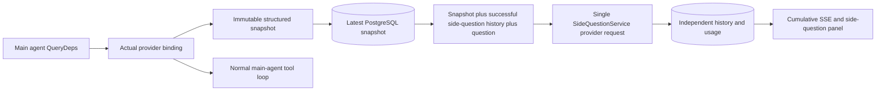

# ARTEX `/btw` side questions

Regular conversations, a task's MainAgent, and Workers launched directly by the
current task support side questions independently of the main conversation.
Enter `/btw question` in the main input to submit a question. Enter `/btw` alone,
or select Side questions, to open history. Desktop uses a resizable sidebar;
mobile uses a drawer.

Answers use an agent-context snapshot captured when the question is submitted.
The panel supports streaming, follow-up questions, stop and clear. Closing the
panel, refreshing the page or disconnecting SSE does not cancel the model request.
Stop affects only the current side question. Clear cancels the request and removes
side-question history while retaining the main context snapshot.

## Implementation scope

The original implementation used Go, Norma 0.3.7, Next.js and the existing Markdown,
ResizablePanel, Drawer and AlertDialog components without modifying Norma or
adding dependencies specifically for this feature. The repository's current
module versions may differ. Planner support, inherited Workers and promotion of
tool-style subtasks were outside that implementation's scope.

- `capture.go` marks only `Options.Deps.CallModel` and `CallModelSync` calls as main
  loop requests. The provider decorator sits inside the individual model, after
  routing has selected a pool member, and records the model actually used.
  Compaction and summary requests do not replace the snapshot.
- Snapshots are published at request start, complete model response and terminal
  execution state. Partial generations are excluded. Norma's `MessagesForAPI`
  preserves tool-call/result pairing. Results enter the next main request or the
  terminal snapshot. Interrupted streams retain the last valid boundary.
- JSON deep copies preserve structured messages, system prompts, tool definitions
  and generation parameters. Inference holds neither snapshot locks nor database
  transactions.
- `SideQuestionService` calls an individual provider. It may summarize history
  first. A final-answer context overflow permits one smaller retry only if no text
  or tool call has been emitted. It creates no agent session and has no connection
  to the tool executor, main transcript, activity stream or task graph. It does not
  use the task's model failover chain. Tool definitions are retained only for
  compatibility with existing structured context; summary requests receive no
  tools. Returned tool calls have no execution path.
- Each parent permits one running request; the service process permits four.
  Each request has a 120-second deadline and its own cancellation context under
  the service lifecycle.
- Requests retain profile references and nonsensitive identity summaries, then
  resolve credentials from current configuration. Deleted profiles or changed
  model/protocol/address identities require running the main agent again to refresh
  the snapshot. Tests do not change the product's default model.

## Persistence and recovery

`db/schema.sql` creates `side_question_sessions` and `side_question_requests`.
Sessions retain the parent, latest snapshot, run ID, version and clear epoch.
Requests retain question, cumulative answer, state, model, snapshot time, usage,
event sequence and pagination ordinal.

A parent key is a conversation ID or a combination of task, exploration and intent
IDs. Workers do not use reusable execution-slot names as identity.

Snapshot writes are coalesced per parent at 250 ms intervals. Database comparisons
of `(run_id, version)` reject stale overwrites. The chosen snapshot is saved once
more immediately before submission. Successful persistence releases the large
in-memory copy; failed writes retain the unsaved version. Cumulative streaming
answers are persisted at most every 250 ms and immediately on terminal state,
with bounded retries on database errors.

Startup marks previously running requests `interrupted`, preserving saved partial
answers and usage without automatically replaying requests. The most recent saved
context is immediately reusable. Older sessions without a snapshot require a new
main-agent run; context is not reconstructed from UI activity logs.

Clear increments the epoch and deletes requests. Conditional writes prevent late
callbacks from recreating cleared data. Physical parent deletion uses foreign-key
cascades. Logical Worker deletion removes side data in the same transaction and
rejects later snapshots. Task archiving blocks admissions, drains the main flow,
cancels side questions and waits for persistence. Archive v3 includes side-question
tables and remains compatible with v1/v2 archives that lack them.

All history is persisted and paginated by ordinal, at most 20 records per page.
Model requests replay at most 20 recent successful question/answer pairs within
the token budget; older pairs enter a rolling summary. If main context exceeds
the budget, only older portions of its side copy are summarized, retaining recent
structured tool calls/results. Preparation, summary calls and usage share the
same concurrency, cancellation and 120-second limits. See
[Context budgets](CONTEXT_BUDGET.md).

## HTTP contract

The following authenticated, resource-validated paths serve as `{parent}`:

- `/api/conversations/{id}`
- `/api/tasks/{id}/chat`
- `/api/tasks/{id}/intents/{iid}`

Requests:

- `GET {parent}/side-questions?before={ordinal}` returns newest-first `items`,
  `current` execution state, `snapshot` metadata and `next_cursor`. Zero means the
  latest-page request or no following page, depending on the field.
- `POST {parent}/side-questions` accepts
  `{ "question": "...", "client_request_id": "UUID" }`. New requests return 202;
  the same ID/question returns the existing object with 200.
- `DELETE {parent}/side-questions` cancels and clears that parent's side history.
- `GET /api/side-questions/{requestID}/events` emits `snapshot` SSE events with an
  increasing event ID and the entire cumulative request object. Clear emits
  `cleared`.
- `POST /api/side-questions/{requestID}/cancel` explicitly cancels a request;
  terminal state is visible through history or SSE.

Questions are limited to 4,000 characters. Missing snapshots, changed profiles,
busy parents and idempotency conflicts return 409; the global concurrency limit
returns 429. Each SSE connection starts with cumulative state, so clients do not
need previously received text fragments. The UI merges by request ID and sequence,
and discards stale callbacks after changing parents or clearing history.

## Validation and references

See [VALIDATION.md](VALIDATION.md) for the historical engineering and model checks.
The independent-request design referenced
[Grok CLI side-question.ts at a fixed commit](https://github.com/superagent-ai/grok-cli/blob/fb97af83f06dca873281d60168430f06c8de6324/src/utils/side-question.ts),
and execution isolation referenced
[OpenCode at a fixed commit](https://github.com/anomalyco/opencode/tree/b3f1a96c6dd7adeb28b36dd11add1998fc84d67b).
ARTEX uses Norma structured context rather than concatenating frontend logs.
