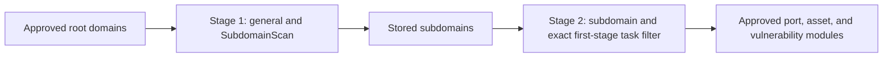

# ScopeSentry MCP guide

This guide assumes an already deployed ScopeSentry instance. Connect through an
MCP client such as Cursor; local ScopeSentry source code is unnecessary. Use only
approved assessment projects and targets. Task creation can initiate real network
activity; confirm authorization and operational constraints first.

## 1. Connection setup

Verify the deployed Web interface and `/mcp` endpoint, including any reverse-proxy
prefix. Prefer HTTPS with certificate verification for API-key traffic. Plain HTTP
is appropriate only within an independently secured local assessment network.

Log into the ScopeSentry Web UI, create an API key through its management page or
the administrator-provided interface, and securely retain the returned `ssk_...`
value; it is shown once. Do not write actual keys into source, reports, or chat.
Configure the MCP client, for example:

```json
{
  "mcpServers": {
    "scopesentry": {
      "url": "https://scopesentry.example/mcp",
      "headers": {"X-API-Key": "ssk_REPLACE_WITH_PRIVATE_KEY"}
    }
  }
}
```

`Authorization: Bearer <private API key>` is also supported by the integration.
Reload the MCP client and confirm tools such as `list_projects` and `list_assets`
appear. ARTEX itself keeps MCP discovery disabled until execution is explicitly
enabled in an isolated assessment environment.

## 2. Tools

| Tool | Purpose |
| --- | --- |
| list_projects | Tagged project tree with IDs |
| list_projects_data | Paginated project list with name search |
| get_project | Project details |
| create_project | Create a project |
| list_tasks / get_task | Scan-task list/details |
| list_scan_templates / get_scan_template | Template list/details |
| list_plugin_modules | Pipeline module names |
| list_plugins | Plugin hashes and default parameters |
| create_scan_template | Create a template |
| create_scan_task | Create a scan task |
| list_assets | Paginated asset query |
| count_assets | Asset count, corresponding to /api/assets/common/total |
| get_asset_detail | Asset/finding details |
| add_asset_tag | Add an asset tag |
| list_nodes | Scanner nodes |

The live MCP schemas are authoritative for supported parameters. `list_assets`
and `count_assets` share asset_type/search/filter semantics. Use count_assets for
totals rather than paging through every asset solely to count it.

## 3. Workflows

### 3.1 Query assets within a project

When a project is already known, use filter.project to narrow queries and avoid
slow cross-project results. Do not invent a project filter without context.
Obtain the ObjectID from list_projects or list_projects_data (`id` or
`children[].value`), then pass the ID, never the display name:

```json
{
  "asset_type":"asset",
  "pageIndex":1,
  "pageSize":20,
  "search":"domain=^example.com",
  "filter":{"project":["<project-object-id>"]}
}
```

### 3.2 Create a scan task

1. Use list_nodes for online node names.
2. Obtain a template ObjectID from list_scan_templates or create_scan_template.
3. Supply required name/node to create_scan_task; template takes an ID, not a name.

| targetSource | Source | Required parameters |
| --- | --- | --- |
| general | Explicit targets | target |
| project | Project targets | project ObjectID array |
| asset | Web asset search | search; optional project/filter/targetNumber |
| RootDomain | Root-domain search | search; optional project/filter/targetNumber |
| subdomain | Subdomain search | search; optional project/filter/targetNumber |
| UrlScan | URL-scan results | search; optional project/filter/targetNumber |
| *Source, such as subdomainSource | Asset-page selection/search | targetTp=search uses search; targetTp=select uses targetIds |

Example explicit approved root-domain collection:

```json
{
  "name":"example-subdomain-collection",
  "node":["node-1"],
  "template":"<template-object-id>",
  "targetSource":"general",
  "target":"example.com\nexample.net",
  "project":["<project-object-id>"]
}
```

Example follow-up using the first task's subdomains:

```json
{
  "name":"example-ports-and-findings",
  "node":["node-1"],
  "template":"<follow-up-template-object-id>",
  "targetSource":"subdomain",
  "search":"task==\"example-subdomain-collection\"",
  "project":["<project-object-id>"]
}
```

### 3.3 Two-stage root-domain discovery

For comprehensive approved root-domain collection, prefer two stages. Distributed
jobs are assigned per target. If a root domain is one target, a single node may
also process every discovered subdomain and later module, creating imbalance.

First run general targets containing the root domains, with a template limited
to SubdomainScan and SubdomainSecurity. Wait for completion using get_task.
Then use targetSource=subdomain and search `task=="<first-stage-task-name>"`,
optionally narrowing by project. A follow-up template can include port scanning,
asset mapping, and vulnerability modules without repeating SubdomainScan.
Subdomains now distribute independently across nodes. The Web subdomain page's
filter-by-task and create-from-subdomains workflow has the same effect.



### 3.4 Create a scan template

Use list_plugin_modules for module names, then list_plugins with an optional
module filter for plugin hashes and default parameter values. create_scan_template
accepts a modules mapping from module name to an array of plugin hashes.

## 4. Asset queries

count_assets returns `{ "total": N }` using the same asset_type/search/filter
inputs as list_assets:

```json
{
  "asset_type":"subdomain",
  "search":"task==\"approved-task-name\"",
  "filter":{"project":["<project-object-id>"]}
}
```

For large datasets, prefer an available project filter and indexed exact/prefix
queries. Do not force a project when none is known.

### 4.1 Asset types

`asset`, `RootDomain`, `subdomain`, `app`, `mp`, `UrlScan`, `SensitiveResult`,
`DirScanResult`, `crawler`, `vulnerability`, `PageMonitoring`, `IPAsset`, and
`SubdomainTakerResult`.

Aliases include web -> asset, vuln -> vulnerability, ip -> IPAsset, url -> UrlScan.

### 4.2 Parameters

| Parameter | Meaning |
| --- | --- |
| pageIndex / pageSize | Pagination, defaults 1 / 20 |
| search | The DSL below |
| filter | Exact-filter JSON below |
| sort | length ordering for UrlScan/DirScanResult only |
| sid | SensitiveResult rule name only |

search and filter can be combined.

### 4.3 Search expressions

This is a custom DSL, not SQL:

| Operator | Meaning | Index behavior | Example |
| --- | --- | --- | --- |
| = | Regex/substring | Usually no index | domain=example |
| == | Exact equality | Indexed fields can use indexes | port==443 |
| != | Exclude | Depends on field/query | port!="80" |
| && | AND | Depends on components | domain==example.com && port==443 |
| \|\| | OR | Depends on components | title=admin \|\| body=login |

Indexed fields such as domain/ip/port/title can benefit from exact equality or
anchored prefixes beginning with `^`, such as domain=^example.com. Unanchored
regex queries over large collections can be slow. Use them only when necessary.

Common search fields across types: tag, task (task name), rootDomain. Project
must be expressed as filter.project; putting it into search is unsupported and
may fail when combined with &&.

| asset_type | Common search fields |
| --- | --- |
| asset | domain, ip, port, service, app, title, statuscode, icon, banner, type, body, header |
| RootDomain | domain, icp, company |
| subdomain | domain, ip, type, value |
| app | name, icp, company, category, description, url, apk |
| mp | name, icp, company, category, description, url |
| UrlScan | url, input, source, resultId, type |
| SensitiveResult | url, sname, body, info, md5 |
| DirScanResult | url, statuscode, redirect, length |
| vulnerability | url, vulname, matched, request, response, level |
| crawler | url, method, body, resultId |
| PageMonitoring | url, hash, diff, response |
| IPAsset | ip, domain, port, service, webServer, app |
| SubdomainTakerResult | domain, value, type, response |

Examples: domain==www.example.com && port==443; domain=^example.com;
ip==192.0.2.10; task=="approved-task-name"; level==high for vulnerability;
statuscode==200 for DirScanResult. Use title=admin only when substring search is
needed, preferably narrowed by project or other criteria.

### 4.4 Exact filters

Values within one key are OR; different keys are AND. When a known project is
supported by the asset type, supply its ObjectID in filter.project.

| Filter key | Values |
| --- | --- |
| project | ObjectIDs from list_projects/list_projects_data |
| task | Task names from list_tasks.name |
| port | Such as "443" |
| service | Such as "https" |
| app | Fingerprints such as "Nginx" |
| icon | Icon hash |
| statuscode | HTTP status, principally asset |
| status | UrlScan/DirScan HTTP code, or finding/sensitive-result disposition |
| level | critical/high/medium/low/info |
| type | Such as A/CNAME subdomain records |
| color / sname | SensitiveResult color/rule name |
| tags | Tags |

| asset_type | Supported filter keys |
| --- | --- |
| asset | project, port, service, app, icon, statuscode, type, task, tags |
| RootDomain | project, tags |
| subdomain | project, type, task, tags |
| app / mp | project, tags |
| UrlScan | status, tags |
| DirScanResult | status, tags |
| SensitiveResult | status, color, sname, tags |
| crawler | project, task, tags |
| vulnerability | project, level, status, task, tags |
| PageMonitoring / SubdomainTakerResult | tags |
| IPAsset | project, port, service, app |

Example exact filter:

```json
{"project":["<project-object-id>"],"port":["443"]}
```

Combined query:

```json
{
  "asset_type":"asset",
  "search":"domain=^example.com && port==443",
  "filter":{"project":["<project-object-id>"]},
  "pageIndex":1,
  "pageSize":10
}
```

Use ObjectIDs rather than project display names. UrlScan status uses filter.status;
DirScanResult also supports search statuscode==200. SensitiveResult rule names use
sname in search or filter.sname. Prefer == for known values and ^ for prefixes;
avoid broad unanchored regex queries.

### 4.5 Sorting

Only UrlScan and DirScanResult honor sort:

```json
{"length":"ascending"}
```

Other types ignore sort and use default time ordering.

## 5. Scan module names

`TargetHandler`, `SubdomainScan`, `SubdomainSecurity`, `PortScanPreparation`,
`PortScan`, `PortFingerprint`, `AssetMapping`, `AssetHandle`, `URLScan`,
`WebCrawler`, `URLSecurity`, `DirScan`, `VulnerabilityScan`, `PassiveScan`.

## 6. Troubleshooting

| Symptom | Check |
| --- | --- |
| No MCP tools | Endpoint URL, API key, running ScopeSentry service |
| 401/403 | Recreate/replace the API key through the approved management flow |
| Missing assets | ObjectID project filter; never project in search |
| Template/task creation fails | Template ObjectID and online node names |
| Slow queries | Narrow supported project scope, prefer ==/^, reduce pageSize |
